# Automações n8n

Exports sanitizados de fluxos n8n que construí com apoio de IA, sob minha direção. Fazem parte do estudo de caso [Redator autônomo de LinkedIn para finanças](https://github.com/lucasmartinsAI/projetos-ia/tree/main/redator-linkedin-financas).

> **English summary.** Sanitized n8n workflow exports: an autonomous LinkedIn writer for finance content (news → curation → draft → fact/compliance checks → art direction → human email approval → post) and two small utilities (PDF/image OCR, daily API-call limiter). Credentials, IDs, emails and personal data were removed. Import them into your own n8n and re-link credentials.

## O que há aqui

| Arquivo | O que faz |
|---|---|
| `linkedin/00-workflow-principal.json` | Coordena tudo: coleta notícias, apura, chama os demais fluxos e salva o rascunho na planilha |
| `linkedin/01-curadoria.json` | Dá nota de relevância, agrupa notícias do mesmo fato e descarta temas recentes |
| `linkedin/02-redacao.json` | Redige o rascunho em primeira pessoa e revisa clareza |
| `linkedin/03-verificacao.json` | Checagem de fatos, adequação ao ambiente regulado e originalidade |
| `linkedin/04-diretor-de-arte.json` | Monta o prompt de imagem, gera a imagem e a guarda no Drive |
| `linkedin/05-aprovacao-email.json` | Envia o rascunho por e-mail e espera APROVADO ou REPROVADO |
| `linkedin/06-postagem.json` | Publica no LinkedIn o rascunho aprovado e registra o horário |
| `utilitarios/ocr-extrair-texto-pdf-imagem.json` | Extrai texto de PDF ou imagem (pdftoppm + tesseract, idioma português) |
| `utilitarios/guarda-limite-uso-api.json` | Contador diário de chamadas por API, para respeitar limites de uso |

## Como o fluxo principal funciona

```mermaid
flowchart LR
  T["Disparo manual<br/>(agendador de 8 em 8 h, desativado)"] --> H["Histórico recente<br/>da planilha"]
  H --> RSS["Feeds RSS de tendências<br/>e de economia"]
  RSS --> AP["Apuração: busca o artigo<br/>(leitor alternativo se bloqueado)"]
  AP --> CU["01 Curadoria<br/>top 3 por nota"]
  CU --> RE["02 Redação"]
  RE --> VE["03 Verificação"]
  VE --> DA["04 Diretor de arte<br/>(imagem)"]
  DA --> PL[("Planilha<br/>aba Rascunhos")]
  PL --> AE["05 Aprovação por e-mail"]
  AE --> D{"Decisão humana"}
  D -- "aprovado" --> PO["06 Postagem no LinkedIn"]
  D -- "reprovado" --> RJ["Marcado como reprovado"]
```

Nesta versão (v1) a imagem é gerada antes do e-mail de aprovação. Deslocar essa etapa para depois da aprovação, para não gastar imagem em rascunho reprovado, é uma das mudanças planejadas para a v2.

## Como importar

1. No n8n, use *Import from file* para cada JSON. Comece pelos sub-fluxos (`01` a `06`) e deixe o `00` por último.
2. No fluxo principal e no `05`, os nós que chamam sub-fluxos trazem os marcadores `ID_DO_FLUXO_*`. Aponte cada um para o fluxo correspondente que você importou.
3. Crie as credenciais (todas aparecem como `CONFIGURAR` no export):
   - modelo de linguagem via API (usei DeepSeek): *Header Auth*, cabeçalho `Authorization: Bearer <sua chave>`;
   - geração de imagem (Gemini): *Header Auth* com a sua chave;
   - Google Sheets, Google Drive e Gmail: OAuth;
   - LinkedIn: OAuth.
4. Substitua os marcadores: `SEU_ID_DA_PLANILHA`, `SEU_ID_LINKEDIN` e `seu-email@exemplo.com`.
5. Crie a planilha com uma aba chamada `Rascunhos` e as colunas abaixo.

### Colunas da planilha

`data`, `topico`, `fontes`, `post_final`, `hashtags`, `status`, `checklist`, `ajustes_feitos`, `especialidade_editoria`, `fact_check_status`, `compliance_status`, `originalidade_score`, `tem_cta`, `imagem_url`, `horario_postado`, `curtidas`, `comentarios`, `compartilhamentos`, `cliente_sintetico_score`, `aprovado_editor`.

Valores de `status`: `pendente`, `bloqueado_compliance`, `bloqueado_factcheck`, `alerta_originalidade`. Só entra no e-mail de aprovação a linha com `post_final` preenchido, status `pendente`, sem `aprovado_editor` e sem `horario_postado`.

## Decisões de projeto

- **Humano aprova antes de publicar.** O e-mail usa o recurso de espera do Gmail no n8n. Sem clique em APROVADO, nada é postado.
- **Bloqueios automáticos.** Rascunho reprovado na checagem de fatos ou de adequação regulatória recebe um status de bloqueio e não segue para aprovação.
- **Alternativa quando o site bloqueia a leitura.** Se o artigo não carrega direto, o fluxo tenta um leitor de páginas externo.
- **Controle de uso.** O utilitário de limite diário existe porque serviços externos têm cota.

## Limitações

- Execução manual. O agendador está desativado.
- Os prompts mantêm regras editoriais genéricas para um assessor de investimentos (por exemplo, evitar promessa de retorno). Adapte ao seu contexto e às normas que valem para você.
- Depende de serviços externos com cota e instabilidade.
- Custo por post e engajamento ainda não foram medidos.

## Segurança do export

Removi credenciais, IDs de planilha, de fluxo e de pessoa, e-mails, caminhos de instância e dados de execução. Revise antes de importar qualquer fluxo de terceiros, inclusive este.
